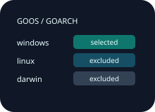

## 🧭 Overview

A Go CLI that previews which local .go files match a selected GOOS, GOARCH, and build-tag set without compiling or modifying the project.

## ✨ Features

- 🧭 Evaluate //go:build expressions and filename suffixes.
- 🖥️ Choose target GOOS and GOARCH values.
- 🏷️ Supply additional build tags.
- 🔒 Read source directories only; never execute files.

## 🎬 Demo

No hosted demo is provided. Run the local examples with the command below.

## ⚡ Quick Start

~~~bash
go run . -dir ./examples -goos windows -goarch amd64
~~~

## 🧰 Tech Stack

- Go 1.22+
- Standard library; no runtime service or external API is required

## 🗂️ Folder Structure

~~~text
go-build-constraints-lab/
├── main.go
├── main_test.go
├── examples/feature_windows.go
├── examples/feature_unix.go
├── examples/feature_default.go
├── go.mod
├── assets/mark.svg
├── .gitignore
├── LICENSE
└── README.md
~~~

## 🗺️ Roadmap

- [x] Core behavior and local examples
- [x] Custom SVG and setup documentation
- [ ] Add more guided exercises from community feedback

## 🤝 Contributing

Issues and focused pull requests are welcome. Keep examples deterministic and within the documented scope.

## 📄 License

MIT License. See [LICENSE](LICENSE).

